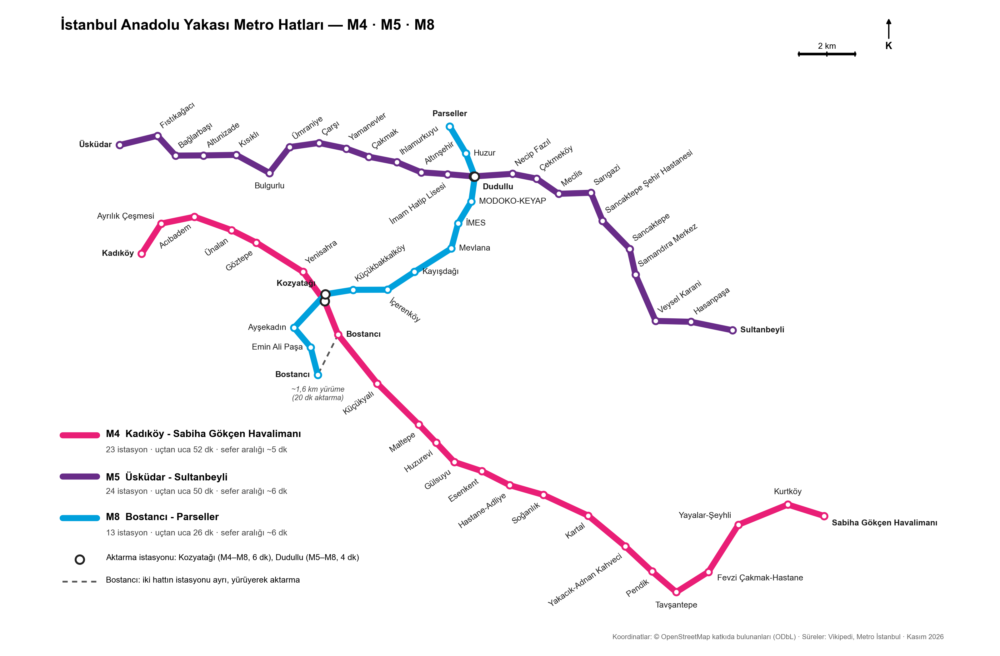

# Kent İçi Rota ve Hat Planlayıcı

İstanbul Anadolu yakasındaki **M4, M5 ve M8** metro hatları üzerinde rota hesaplayan, C ile yazılmış bir komut satırı uygulaması. Veri Yapıları ve Algoritmalar dersi final projesi.



*57 istasyon; aktarma noktaları Kozyatağı (M4–M8) ve Dudullu (M5–M8). Bostancı'da iki hattın istasyonu ~1,6 km ayrı olduğu için yürüme aktarması olarak modellendi.*

```
Kadıköy -> Ümraniye
Toplam 60.7 dk  (yolculuk 42.2 + bekleme 8.5 + yurume 10.0)  |  2 aktarma  |  22.5 km  |  ort. yogunluk 2.7/5

  [M4] Kadıköy -> Kozyatağı  (6 istasyon, 13.7 dk)
       Kadıköy, Ayrılık Çeşmesi, Acıbadem, Ünalan, Göztepe, Yenisahra, Kozyatağı
   <> Kozyatağı: M4 -> M8 aktarmasi (6 dk yurume + ~3.0 dk bekleme)
  [M8] Kozyatağı -> Dudullu  (7 istasyon, 14.9 dk)
       Kozyatağı, Küçükbakkalköy, İçerenköy, Kayışdağı, Mevlana, İMES, MODOKO-KEYAP, Dudullu
   <> Dudullu: M8 -> M5 aktarmasi (4 dk yurume + ~3.0 dk bekleme)
  [M5] Dudullu -> Ümraniye  (7 istasyon, 13.6 dk)
       Dudullu, İmam Hatip Lisesi, Altınşehir, Ihlamurkuyu, Çakmak, Yamanevler, Çarşı, Ümraniye
```

## Özellikler

- **En hızlı rota**: Dijkstra ve A* (ikisi de aynı sonucu verir, A* daha az durum açar)
- **En az aktarmalı rota**: 0-1 BFS ile en az aktarma sayısı bulunur, sonra bu sayıyı aşmayan rotalar arasından en hızlısı seçilir
- **Çok kriterli rota**: süre, aktarma ve kalabalık için ağırlıklar seçilebilir (hazır profiller ya da özel ağırlıklar)
- **Kapalı yollar**: iki istasyon arasındaki bağlantı çalışma sırasında kapatılıp açılabilir, işlemler **undo/redo** ile geri alınıp yinelenebilir
- **Canlı yoğunluk**: durak yoğunluğu (1–5) elle ayarlanabilir veya rastgele simüle edilebilir, en kalabalık duraklar sıralı listelenir
- **Durak araması**: Türkçe karakter gerekmez (`kadikoy` → Kadıköy) ve önek ile otomatik tamamlama yapılır (`koz` → Kozyatağı)
- **Algoritma karşılaştırması**: aynı sorgu için Dijkstra, A* ve en az aktarma; süre ve açılan durum sayısıyla yan yana
- **Performans ölçümü**: 100 000 duraklı sentetik şehirlere kadar ölçüm yapılır, sonuçlar CSV'ye yazılır

## Derleme ve çalıştırma

Gereken tek şey bir C11 derleyicisi (clang veya gcc) ve `make`. Harici kütüphane kullanılmıyor.

```bash
make                 # bin/rota
./bin/rota           # etkileşimli menü
```

Menüsüz tek sorgu:

```bash
./bin/rota --route kadikoy umraniye          # en hızlı rota
./bin/rota --transfers kartal "emin ali pasa" # en az aktarmalı rota
./bin/rota -d baska_veri --route A B          # farklı veri klasörü
```

Diğer hedefler:

```bash
make test        # birim testleri (veri yapıları + rota)
make sanitize    # testleri AddressSanitizer + UBSan ile çalıştırır
make bench       # performans ölçümleri -> results/ds.csv, results/routes.csv
make bench-quick # kısa ölçüm
make clean
```

### Menü

```
1) Durak ara                     7) Kapali yollari listele
2) En hizli rota                 8) Geri al (undo)
3) En az aktarmali rota          9) Yinele (redo)
4) Cok kriterli rota            10) Yogunluk (listele / guncelle / simule et)
5) Yol kapat                    11) Algoritma karsilastirmasi
6) Yol ac                        0) Cikis
```

## Ders gereksinimlerinin karşılanması

| Gereksinim | Karşılığı | Dosya |
|---|---|---|
| Dengeli ağaç veya Trie | Trie: durak adında önek arama | `src/trie.c` |
| BFS / Dijkstra / A* | Üçü de var: en hızlı (Dijkstra, A*), en az aktarma (0-1 BFS) | `src/route.c` |
| En az iki sıralama + binary search | quicksort, mergesort (kararlı), binary search | `src/sort.c` |
| Stack, gerçek kullanım | Rota geri izleme, undo/redo | `src/stack.c`, `src/history.c` |
| Queue, gerçek kullanım | 0-1 BFS'te çift uçlu kuyruk | `src/queue.c` |
| Konuya özel yapılar | Adjacency list graf, min-heap, hash tablosu (durak dizini) | `src/graph.c`, `src/heap.c`, `src/hash.c` |
| Ekstra: kapalı yollar | Dinamik bağlantı kapatma + undo/redo | `src/graph.c`, `src/history.c` |
| Ekstra: canlı yoğunluk | Yoğunluk puanı, simülasyon, çok kriterli maliyet | `src/graph.c`, `src/route.c` |
| CSV girdi + CLI | 4 CSV dosyası, menü ve tek sorgu modu | `src/io_csv.c`, `src/main.c` |
| Zaman/uzay analizi | Her işlem için tablo + ölçümler | [docs/KARMASIKLIK.md](docs/KARMASIKLIK.md) |

## Tasarım

### Aktarma modellemesi
Graf düğümleri duraklar değil, **(durak, hat)** çiftleridir; kodda bunlara "durum" (state) denir. Kozyatağı iki durumdan oluşur: (Kozyatağı, M4) ve (Kozyatağı, M8).

- **RIDE kenarı**: aynı hattaki komşu istasyonlar arası yolculuk (süre, km)
- **TRANSFER kenarı**: aynı istasyonda hat değiştirme (yürüme süresi + yeni hattı bekleme)

Bu sayede algoritmalar hangi hatta olunduğunu bilir, aktarmaları sayabilir ve aktarmaya ayrı bir maliyet verebilir.

### Maliyet modeli
- İlk biniş: hattın sefer aralığının yarısı (ortalama bekleme)
- Yolculuk: kenarın süresi
- Aktarma: yürüme + yeni hattın sefer aralığının yarısı
- Çok kriterli: `w_süre × süre + w_aktarma × aktarma + w_yoğunluk × (girilen istasyonun yoğunluğu − 1)`

"En hızlı rota", ağırlıklı Dijkstra'nın `{1, 0, 0}` ağırlıklı halidir.

### Klasör yapısı

```
├── Makefile
├── data/          stops.csv, lines.csv, edges.csv, transfers.csv + README (kaynaklar, varsayımlar)
├── include/       başlık dosyaları (her yapının karmaşıklığı başlıkta yazılı)
├── src/
│   ├── main.c     CLI menü
│   ├── graph.c    ağ: adjacency list, dizinler, kapalı yollar, yoğunluk
│   ├── route.c    Dijkstra, A*, 0-1 BFS, katmanlı Dijkstra, yazdırma
│   ├── history.c  undo/redo
│   ├── io_csv.c   CSV okuma ve hata raporlama
│   ├── gen.c      sentetik ızgara şehir üreteci
│   └── stack.c queue.c heap.c hash.c trie.c sort.c text.c common.c
├── tests/         test_ds.c (veri yapıları), test_route.c (ağ ve algoritmalar)
├── bench/         bench.c (performans ölçümü)
├── results/       ölçüm sonuçları (CSV)
└── docs/          KARMASIKLIK.md
```

## Veri

57 istasyon, 3 hat, 57 bağlantı, 3 aktarma noktası. Ayrıntılar ve varsayımlar [data/README.md](data/README.md) dosyasında.

- İstasyon listesi ve uçtan uca süreler Türkçe Vikipedi'den alındı. Durumu 24.11.2026 itibarıyla hizmette olan istasyonları yansıtıyor.
- Koordinatlar: © OpenStreetMap katkıda bulunanları, ODbL lisansı
- İstasyonlar arası süreler, hat toplam süresinin mesafeye orantılı paylaştırılmasıyla bulundu. Sefer aralıkları, yürüme süreleri ve yoğunluk puanları tahmini değerler.
- **Bostancı:** M4 ve M8'in Bostancı istasyonları yaklaşık 1,6 km uzakta ve aralarında fiziksel bağlantı yok. Bu yüzden 20 dakikalık yürüme aktarması olarak modellendi.

CSV hatalı satır içerirse program çökmez: satır `dosya:satır: açıklama` biçiminde raporlanır ve atlanır.

## Testler

```
$ make test
stack OK  queue OK  heap OK  text OK  hash OK  trie OK  sort OK      187 kontrol, 0 hata
load OK  search OK  fastest OK  closures OK  transfers OK  history OK
weighted OK  crowd OK  astar OK  grid OK  bad data OK                 123 kontrol, 0 hata
```

Testlerin kapsadıkları:
- Sıralamalar 5 farklı girdi tipinde C'nin `qsort` fonksiyonuyla karşılaştırılıyor
- 3249 durak çiftinin hepsinde A* = Dijkstra kontrol ediliyor, sezgiselin kabul edilebilir olduğu ve en az aktarma tutarlılığı doğrulanıyor
- Kapalı yollarda rota değişimi ve undo/redo sırası (LIFO) test ediliyor
- Bozuk CSV dosyaları test ediliyor

Ayrıca AddressSanitizer/UBSan altında hiçbir hata görülmedi, macOS `leaks` aracı da bellek sızıntısı bulmadı.

## Performans (özet)

| Ağ | Durak | Dijkstra | A* | A*'ın açtığı durum |
|---|---|---|---|---|
| Izgara 32×32 | 1K | 0,049 ms | 0,029 ms | %18 (Dijkstra %50) |
| Izgara 100×100 | 10K | 0,65 ms | 0,36 ms | %21 (Dijkstra %56) |
| Izgara 316×316 | 100K | 12,6 ms | 6,6 ms | %27 (Dijkstra %63) |
| M4+M5+M8 | 57 | ~1 µs | ~1 µs | %42 (Dijkstra %51) |

Veri yapısı ölçümleri ve yorumları için: [docs/KARMASIKLIK.md](docs/KARMASIKLIK.md)

## Kısıtlar ve gelecek çalışmalar

- Ağ neredeyse ağaç şeklinde, tek gerçek alternatif M4–M8 arasındaki Kozyatağı ve Bostancı aktarmaları. Bu yüzden bu veri setinde en hızlı rota her zaman zaten en az aktarmalı rota. Çok kriterli rotanın etkisi de sınırlı.
- **Marmaray** eklenirse (Ayrılık Çeşmesi, Bostancı, Pendik ve Üsküdar'da kesişir) ağda döngüler oluşur ve rota modları birbirinden belirgin şekilde ayrışır. Bunun için sadece CSV satırı eklemek yeterli, koda dokunmak gerekmez.
- Gerçek sefer saatleri (GTFS) kullanılmıyor, bekleme süreleri ortalama değerler.
- Trie her düğümde 37 işaretçi tuttuğu için bellek açısından cömert. Büyük sözlüklerde sıkıştırılmış trie (radix tree) daha uygun olur.
